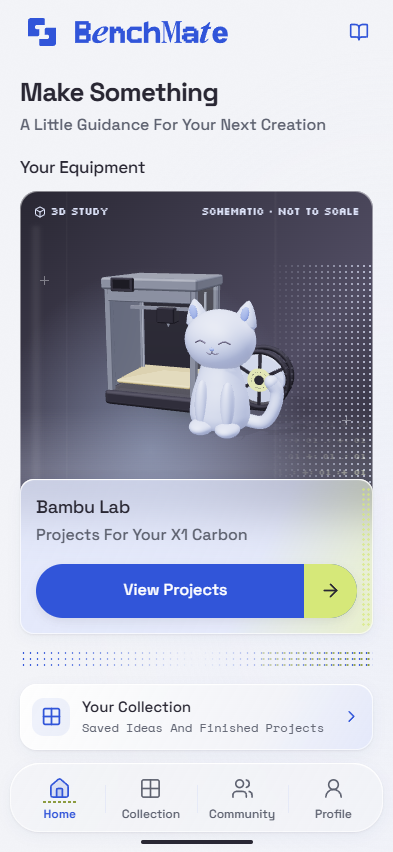

# Benchmate

A polished, runnable **iPhone browser mockup** implementing the approved R9 journey in the existing React 19, Vite and Three.js app. Electric Blue and Acid Lime accents, Cloud and White glass, controlled matrix textures and a reusable cloud-blue 3D cat connect discovery, preparation, recovery and completion.



Independent prototype. Bambu Lab is the equipment manufacturer, not a sponsor or partner. This is a browser app, not a native iOS build. No printer connection, printable cat model or physical validation is implied.

## Run

Node 22.12+ and npm are required. This workspace was tested with Node 24.14.0.

```powershell
npm ci
npm run dev -- --port 5174 --strictPort
```

Open **http://127.0.0.1:5174/**. The implementation session uses 5174 because 5173 was already occupied. No credentials, environment variables or paid services are needed. Fonts, geometry, icons and the demonstration image are local.

```powershell
npm test
npm run build
npm run preview -- --port 4174 --strictPort
```

Production preview: **http://127.0.0.1:4174/**. Browser storage is separate for each origin, including each port.

## Explore

- **Home → Bambu Projects → Little Cat → Start This Project**. Name the cat, choose My Desk or A Gift, review setup, plate and material, then enter the Bambu Studio handoff demonstration.
- Accept the first-layer illustration, continue to the demo finish, review cooling and release, and check **both** object and workspace items. Completion creates a local Collection record. Add a note and download the text record.
- At **Something Looks Wrong**, select a photo, open the camera, or choose **Use Demo Image**. The same image remains through processing and review. Arbitrary photos are explicitly **not analyzed**. Only the synthetic demonstration illustrates a possible lifting edge.
- **Review Next Step** opens end-job/cooling confirmations, cleaning, reviewed setup and repeat preparation. **Get More Help** preserves the issue and offers a downloadable summary and official support link.
- **Save And Pause** preserves the exact checkpoint, issue, photo and recovery confirmations through reload. It never pauses the physical printer.
- Collection supports saved ideas and completed records. Ripple Tray and Cable Pebble are explicit previews without guides. Profile edits, reduced-motion preference, fictional Community appreciations and local discussion drafts persist.
- **Share Your Make → Preview Post** creates a reviewable private preview. Nothing is uploaded or published.

## Verification

**17 state/persistence tests pass. Production build passes.** The lazy Three.js chunk produces a nonblocking size warning (about 131 KB gzip).

The production browser suite passed the complete main path, both issue branches, image selection/errors, cancellation, demo processing, Help/disclosures, pause/reload/resume, collection records, actual downloads, profile, private share preview and local community interactions. It captured **393 × 852**, **320 × 740**, **430 × 932** and **1440 × 1000** views, exercised keyboard focus and reduced motion, and forced non-WebGL fallback. No application exceptions were observed.

Camera capture and cancellation were tested with a **synthetic browser media stream**, including released tracks; permission rejection was simulated. A physical camera, real iPhone/Safari, virtual keyboard and screen reader were not tested.

- [Implementation Gallery — All Eight R9 Chapters](docs/evidence/brand-refresh/review.html)
- [Desktop](docs/evidence/brand-refresh/showcase-home-1440.png) · [393px Home](docs/evidence/brand-refresh/01-home-393.png) · [320px Home](docs/evidence/brand-refresh/showcase-home-320.png)
- [Photo Help](docs/evidence/brand-refresh/board-4.png) · [Recovery](docs/evidence/brand-refresh/board-5.png) · [Completion And Sharing](docs/evidence/brand-refresh/board-7.png)
- [Machine-Readable Browser Results](docs/evidence/brand-refresh/verification.json) · [Brand Refresh And Verification](docs/evidence/brand-refresh/REVIEW.md)

To repeat the browser checks, install Playwright's Chromium once, build and start the production preview above, then run:

```powershell
npx playwright install chromium
npm run test:browser
node scripts/verify-brand.mjs
npm run evidence:gallery
```

Alternatively, set `BENCHMATE_CHROME` to an existing Chromium executable. `BENCHMATE_URL` overrides the default `http://127.0.0.1:4174`. Tests use an isolated browser profile; they do not reset your regular browser's project.

## Local Data

Schema version 2 retains the original storage key, `benchmate.project.v1`. Version 1 projects migrate without losing names, notes, checkpoints or unresolved issues; the original is backed up as `benchmate.project.v1.backup`. Unsupported/corrupt data is copied to a timestamped recovery key with a visible notice. Failed backups prevent overwriting the original.

Completed records are independent of the next guide. **Profile → Preferences → Reset Current Guide** resets only the current guide after confirmation, preserving records, saved ideas, identity and local drafts. Clearing site data removes local records and photos. Exports are text only and exclude image bytes. There is no cross-device sync or offline-installable PWA.

## Implementation And Limits

| Implemented | Local Simulation Or Remaining Limit |
|---|---|
| Connected R9 navigation and state-derived phase markers | Guide acknowledgments do not prove physical progress |
| Editable identity, saved ideas, records and drafts | No authentication, remote accounts, posting or messaging |
| Browser file picker, camera flow and consistent image review | No vision backend, diagnosis or confidence score |
| Source-linked help, bounded recovery and support export | No machine control, sensing, timing or temperature feeds |
| Live reusable 3D cat, printer, seated plate, spool and preview forms | Schematic geometry, not manufacturer CAD or a validated print mesh |
| Glass components, matrix edges, keyboard focus and reduced effects | Real iPhone/Safari and assistive-technology testing remains |
| On-demand rendering, GPU cleanup and SVG fallback | No continuous animation or simulated live printer telemetry |

Equipment guidance retains the original [source register](docs/source-register.md), read on 13 October 2026: X1 Carbon, assumed 0.4 mm nozzle, loaded Bambu PLA Basic external spool and X1 Textured PEI plate. No new temperature, duration, print profile or safety threshold was invented.

## Structure

```text
src/MobileApp.jsx                 Navigation, persistence, task shell and sheets
src/components/UI.jsx            Glass, actions, rows, disclosures, phase rail, tabs
src/components/Browse.jsx         Home, catalog, collection, community, profile, sharing
src/components/GuideContent.jsx   Tasks, recovery, pause and completion
src/components/PhotoHelp.jsx      File/camera lifecycle and consistent photo display
src/components/Sheets.jsx         Contextual help, source links and local settings
src/components/ProductScene.jsx  Lazy 3D mount and accessible SVG fallback
src/scene/createScene.js          Original procedural geometry and materials
src/state.js                     Versioned reducer, migration, records and exports
src/data/                        Equipment authority and authored presentation
src/mobile.css                   Glass, matrix and responsive layout
src/brand.css                    Final brand tokens and three local font families
public/brand/                    Supplied logo, wordmark and asset provenance
public/fonts/                    Space Grotesk, Space Mono and Silkscreen
public/demo-first-layer.svg      Original synthetic first-layer example
scripts/verify-r9.mjs            Isolated production-browser verification
scripts/evidence-gallery.mjs     Gallery of actual implementation captures
```

The original PANDA archive and all R1–R9 concept packets remain intact. R9 **reference** images stay in [the original concept packet](docs/design/revisions/benchmate-20261014-workflow-r9/review.html); current implementation evidence is separate. Historical R2 source/document snapshots are in [the implementation baseline](docs/evidence/r9-implementation/baseline/). See [design.md](design.md) and [planning.md](planning.md) for current decisions and validation boundaries.

