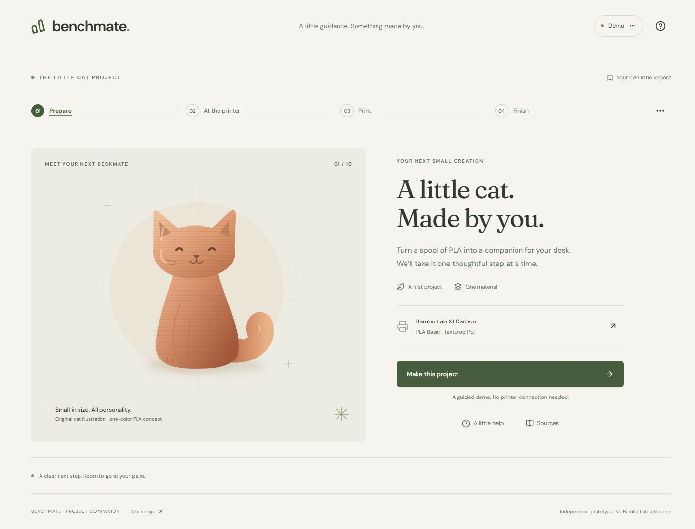

# Benchmate — Weave refinement review

**Status: implementation ready; selected reference implemented and browser-checked. Owner acceptance remains pending.**

- [Contact sheet: one actual candidate, selected](references/contact-sheet.png)
- [Actual generated state board](references/images/img-01-benchmate-state-board.png)
- [Provenance, approval and run ID](provenance.json)
- [Exact input and settings](prompt.json)
- [Before: working desktop entry](implementation/before/desktop-entry.jpg)
- [After: final desktop entry](implementation/after/desktop-entry.jpg)
- Video: none; this pass changed static presentation only.

| Before | After |
|---|---|
|  |  |

Matching entry state in the same Chrome browser, both with a 1440 × 1000 viewport override; full-page captures. No browser zoom or OS display-scale change was made. Physical DPI was not independently measured.

## Execution

Used the installed official Figma MCP direct-model route from `GenUI_Agent/docs/design/FIGMA_WEAVE.md`. `weave_list_tools` returned zero published tools; this did **not** block direct models. `weave_find_model` resolved Nano Banana 2.1. A quote-only call returned 5 credits; the user explicitly approved; exactly one run was submitted. Prediction `b36e46c3-bd90-4859-9311-d14b40099557` completed as a 2752 × 1536 PNG and reported a cost of 5 Weave credits. No uploads, web search, frame sync, graph creation, additional runs or inherited credit budget.

The initial implementation was built before the user directed the search to GenUI_Agent. That initial pass is **not claimed as compliant pre-implementation Weave work**. This packet precedes and governs the final bounded visual refinement. Existing functional work is preserved.

## Actual inspection and implementation contract

The board has a large left desktop entry, three right key states and a small mobile sketch. Selected: warm ivory/forest hierarchy, tactile terracotta print lines, confident serif type, compact phase underline, amber recovery emphasis, named completion and 8 px corners. The board validates an object-led composition; it does not provide equipment facts.

Retain the original smiling vector cat instead of the reference's faceless photorealistic one. Retain legible native text and semantic controls. Omit the board's outer presentation frame, textured background, misspellings and decorative technical markings. No generated text is used as a procedure or label without rebuilding it from authored data.

Final edits are scoped to `src/styles.css`, `src/refinement.css`, `src/main.jsx`, `src/components/Illustrations.jsx`: stronger print material, current-phase underline, more readable copy/contrast, a cleaning-specific focus graphic and a completion headline using the user's project name. `refinement.css` was added as the isolated final static layer. No new animation; no motion study required for this static pass. All earlier checks remain recorded, with relevant checks repeated after edits.

## Result and verification

The interface preserves the board's object/action balance and restrained color treatment, but retains the original smiling cat and evidence-backed native copy. Compare the large object stage, underlined active phase, olive primary action and named finish. The recovery graphic is an original detergent/plate illustration, not a traced manufacturer image.

- [Mobile entry](../../../evidence/mobile-final.jpg)
- [Mobile recovery](../../../evidence/mobile-recovery-final.jpg)
- [Desktop recovery](../../../evidence/recovery-final.jpg)
- [Named completion after one recovery](../../../evidence/completion-final.jpg)
- [Source hashes after implementation](source-hashes-after.json)

Seven state tests and production build passed. Final browser checks repeated personalization, Enter activation, recovery, refresh at the unresolved restart checkpoint, completion gating and the named gift finish. Desktop and narrow layouts were visually inspected; no horizontal overflow was observed. Rendered contrast failures in several muted text styles were corrected within this pass. No app-origin error appeared in the sampled final console log. Complete verification and untested areas are in [planning.md](../../../../planning.md).

Selection is an implementation decision, not owner acceptance. No physical printing, touchscreen device, screen-reader or cross-browser testing was performed. The generated bitmap is neither validated equipment guidance nor proof of runtime behavior.
